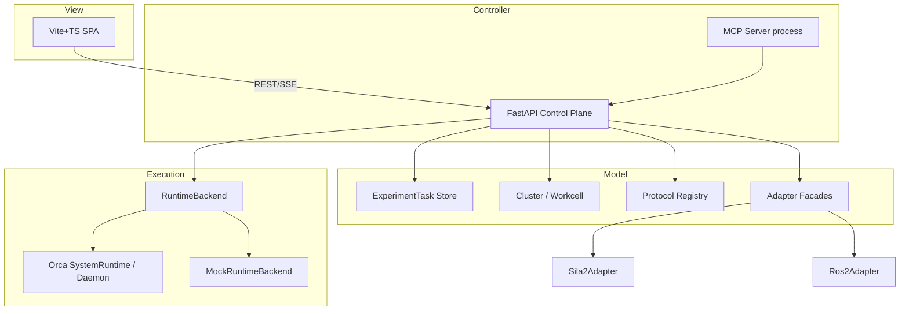

# 设计规格（DS）— orca_2 MVC 扩展

> 路径约定：`doc/spec/ds.md`  
> 依据：`doc/spec/urs.md`、`ref/requirement.md`、调研专报  
> 更新日期：2026-10-10

## 1. 设计目标与原则

1. **非侵入**：不修改上游预约/死锁/SystemMap 内核；扩展放在 `src/orca_mvc/`（若 monorepo 策略需要，可对称使用 `extensions/mvc/`，二选一，推荐前者便于 import）。  
2. **控制面与执行面分离**：MVC 控制面管理 ExperimentTask/Cluster；执行面通过 `RuntimeBackend` 对接 Orca 或 Mock。  
3. **契约优先**：SiLA2/ROS2/MCP 先接口与 mock，再真机。  
4. **安全默认**：监听 `127.0.0.1`；文档警告无认证风险。  

## 2. 逻辑架构（MVC）



### 2.1 Model

#### ExperimentTask

| 字段 | 类型 | 说明 |
|------|------|------|
| id | str | uuid |
| name | str | 显示名 |
| protocol_ref | str | 预注册 workflow/protocol 名 |
| workcell_id | str | 目标 cell |
| run_mode | str | PURE_SIM / DEVICE_SIM / LIVE / MOCK |
| params | dict | 变量覆盖 |
| priority | int | 默认 0 |
| status | enum | pending, queued, running, completed, failed, cancelled |
| execution_ref | str\|null | 后端 execution/submission id |
| created_at / updated_at | datetime | ISO8601 |
| error | str\|null | 失败信息 |

状态迁移（Phase1）：

```text
pending → queued → running → completed
                         ↘ failed
pending|queued|running → cancelled
```

#### Workcell

| 字段 | 说明 |
|------|------|
| id | 唯一 id |
| name | 显示名 |
| devices | 设备名列表（逻辑） |
| transporters | 臂/桥名列表 |
| status | idle / busy / fault / offline |
| topology_ref | 可选：指向 Orca topology 构建符号 |

#### Cluster

| 字段 | 说明 |
|------|------|
| id | 集群 id |
| workcells | Workcell[] |
| links | {from_cell, to_cell, link_type, supports_deadlock_parking} |

`link_type`：`translator` | `human_window` | `placeholder`。

#### Protocol 映射到 Orca 层级

| 控制面 | Orca |
|--------|------|
| ProtocolRef.name | WorkflowTemplate.name / `@orca.workflow(name=...)` |
| Task 提交 | Submission → Execution |
| 多样本 | labware groups |
| 单板路径 | Labware Thread |
| 步骤段 | Method |
| 设备步 | Action → Operation(s) → Driver |

Phase1：`MockRuntimeBackend.submit` 仅记录映射并异步推进状态；`DaemonRuntimeBackend`（可选）调用 daemon REST（端点以上游 OpenAPI/源码为准，实现时核对，**禁止编造路径**）。

### 2.2 Controller（HTTP API 草案）

Base：`http://127.0.0.1:8100/api/v1`

| Method | Path | 说明 |
|--------|------|------|
| GET | /health | 健康检查 |
| GET | /tasks | 列表 |
| POST | /tasks | 创建（pending） |
| POST | /tasks/{id}/submit | 提交运行 |
| GET | /tasks/{id} | 详情 |
| POST | /tasks/{id}/cancel | 取消 |
| GET | /cluster | 当前集群拓扑与状态 |
| POST | /cluster/load | 加载 JSON 拓扑 |
| GET | /adapters | SiLA2/ROS2 状态 |
| POST | /adapters/sila2/call | mock 调用 |
| POST | /adapters/ros2/call | mock 调用 |
| GET | /events | SSE（可选 Phase1） |

Pydantic schema 与上表字段对齐。CORS：允许前端源（如 `http://127.0.0.1:5173`）。

### 2.3 View

- 技术：Vite + TypeScript + 轻量 UI（可用原生 CSS，避免重依赖）。  
- 端口：`5173`（示例）。  
- 页面：任务表、提交表单、Workcell 卡片、适配器状态。  
- 数据：轮询 `GET /tasks` 与 `GET /cluster`（2s）；若实现 SSE 则优先。  

### 2.4 适配器契约

```python
class Sila2Adapter(Protocol):
    async def connect(self) -> None: ...
    async def disconnect(self) -> None: ...
    async def list_features(self) -> list[str]: ...
    async def call_command(self, feature: str, command: str, params: dict) -> dict: ...
    def health(self) -> dict: ...  # {"name":"sila2","mode":"mock","status":"online"}

class Ros2Adapter(Protocol):
    async def connect(self) -> None: ...
    async def list_topics(self) -> list[str]: ...
    async def publish(self, topic: str, message: dict) -> None: ...
    async def call_service(self, service: str, request: dict) -> dict: ...
    def health(self) -> dict: ...
```

Mock 实现写入内存调用日志，供测试断言。

### 2.5 MCP Server

- 进程可与控制面同机；调用控制面 HTTP 或 in-process service。  
- Tools：

| Tool | 参数 | 行为 |
|------|------|------|
| list_tasks | 无 / status? | 调 GET /tasks |
| submit_task | name, protocol_ref, workcell_id, params? | POST 创建+提交 |
| get_status | task_id | GET /tasks/{id} |
| list_workcells | 无 | 从 GET /cluster 提取 |

安全：Phase1 本机；README 写明勿暴露公网。

### 2.6 RuntimeBackend

```python
class RuntimeBackend(Protocol):
    async def submit(self, task: ExperimentTask) -> str:  # returns execution_ref
        ...
    async def get_execution_status(self, execution_ref: str) -> str: ...
    async def cancel(self, execution_ref: str) -> None: ...
```

`MockRuntimeBackend`：submit 后创建后台 asyncio 任务，按步骤 pending→running→completed（可配置时长）。  
`OrcaDaemonBackend`（Phase1 可选/骨架）：读取环境变量 `ORCA_DAEMON_URL`（默认 `http://127.0.0.1:8000` 或以上游实际端口为准），**实现前必须对照 daemon 路由源码**，本 DS 不虚构具体路径字符串以外的「假 API」。

## 3. 建议目录结构

```text
src/orca_mvc/
  __init__.py
  models/
    task.py
    cluster.py
    enums.py
  store/
    memory.py
  api/
    app.py
    routes_tasks.py
    routes_cluster.py
    routes_adapters.py
  runtime/
    base.py
    mock_backend.py
    daemon_backend.py      # 可先 stub
  adapters/
    sila2.py
    ros2.py
  mcp/
    server.py
    tools.py
  services/
    task_service.py
examples/
  mvc/
    cluster_two_cells.json
    demo_submit.md
frontend_mvc/                 # 或 orca_mvc/web
  package.json
  src/App.ts
tests/
  orca_mvc/
    test_tasks_parallel.py
    test_cluster.py
    test_adapters.py
    test_mcp_tools.py
```

## 4. 示例集群拓扑（JSON）

```json
{
  "id": "cluster_demo",
  "workcells": [
    {
      "id": "cell_a",
      "name": "Workcell A",
      "devices": ["shaker_a", "sealer_a", "lh_a"],
      "transporters": ["arm_a"],
      "status": "idle"
    },
    {
      "id": "cell_b",
      "name": "Workcell B",
      "devices": ["reader_b", "shaker_b"],
      "transporters": ["arm_b"],
      "status": "idle"
    }
  ],
  "links": [
    {
      "from_cell": "cell_a",
      "to_cell": "cell_b",
      "link_type": "translator",
      "link_id": "bridge_ab",
      "supports_deadlock_parking": false
    }
  ]
}
```

跨 cell 转运占位对象（服务内）：

```json
{
  "transfer_id": "...",
  "labware_id": "plate-demo",
  "from_cell": "cell_a",
  "to_cell": "cell_b",
  "state": "requested"
}
```

`state`：`requested | in_transit | arrived | failed`。

## 5. 与上游模块的交互边界

| 允许 | 禁止（Phase1） |
|------|----------------|
| 调用 SystemRuntime / daemon HTTP | 改 deadlock_manager 算法 |
| 订阅事件 bus（若可） | 改 PathScoring 默认权重进主线 |
| 新增 orca_mvc 包与测试 | 删除/替换上游装饰器语义 |
| 文档与示例 | 在无鉴权下默认绑定公网 |

## 6. Phase1 实现边界（供云端开发执行）

必须可运行的最小闭环：

1. 多 ExperimentTask 并行提交与状态管理（控制面；后端 Mock 可）。  
2. 多 workcell 拓扑（≥2 cell JSON + 跨 cell 转运占位）。  
3. SiLA2 / ROS2：接口契约 + mock adapter。  
4. MCP Server：list_tasks / submit_task / get_status。  
5. 独立前端 Web 服务（分离端口），任务列表 + workcell 状态。  
6. pytest 覆盖控制面关键路径；README 启动说明。  
7. 遵循 AGENTS.md / spec/*；中文注释可接受，标识符英文。  

## 7. 启动说明（设计期望，实现后写入项目 README）

```bash
# 后端控制面
python -m orca_mvc.api.app   # 或 uvicorn orca_mvc.api.app:app --port 8100

# MCP（另终端）
python -m orca_mvc.mcp.server

# 前端
cd frontend_mvc && npm install && npm run dev
```

## 8. 测试设计要点

- 并行：同时 submit 两个 task，断言均可 running。  
- 拓扑：load JSON，断言 len(workcells)==2。  
- 适配器：call 后 health 与 log。  
- MCP：tool 返回含 task id。  

## 9. 后续设计钩子（非 Phase1）

- OAuth2/API Key 网关；  
- 真实 SiLA2 客户端；  
- rclpy 节点；  
- 任务分配优化器；  
- 前端 recovery/blockers 面板对接 Orca 事件。  

## 10. 修订记录

| 版本 | 日期 | 说明 |
|------|------|------|
| 0.1 | 2026-10-10 | 首版 MVC 扩展设计，指导 Phase1 实现 |
