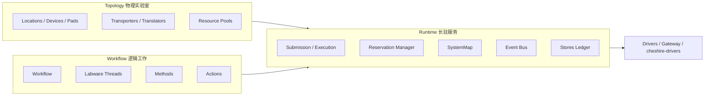
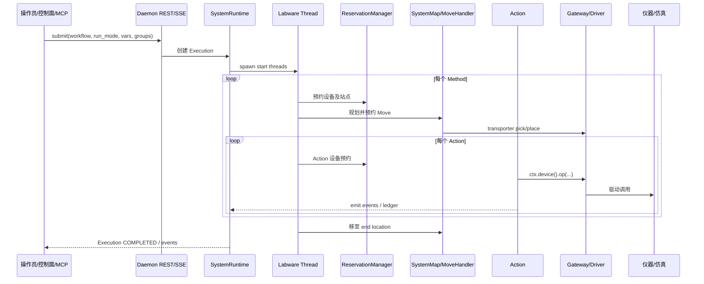
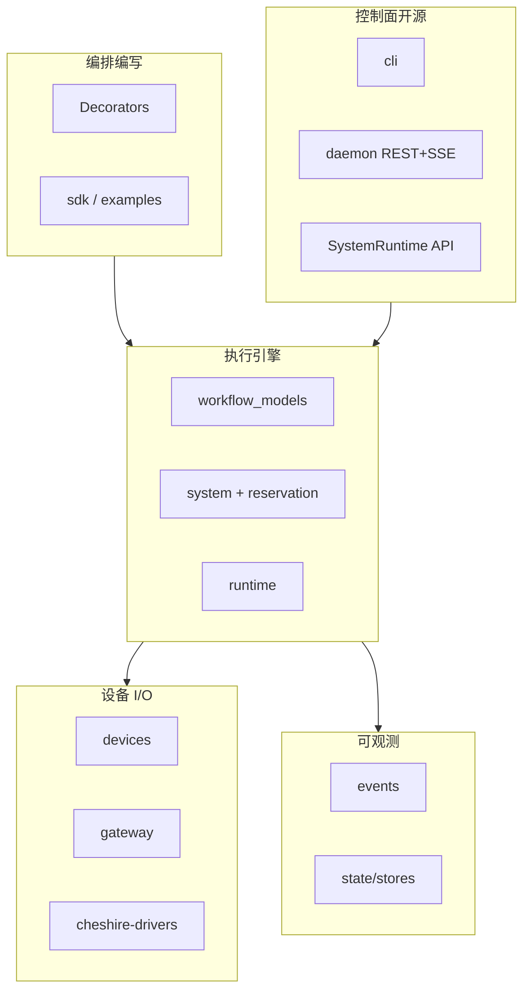

# 专报：Orca 开源实验室自动化中控框架调研

> 文档类型：专题调研报告（AGENTS.md 之「专题名.md」）  
> 对象仓库：上游 [Cheshire-Labs/orca](https://github.com/Cheshire-Labs/orca)；Fork [Hanson-83/orca_2](https://github.com/Hanson-83/orca_2)  
> 官网 / 文档：[cheshirelabs.io](https://cheshirelabs.io/) · [Intro](https://cheshirelabs.io/docs/orca/intro) · [Architecture](https://cheshirelabs.io/docs/orca/architecture/)  
> 编写日期：2026-10-10（Asia/Shanghai）  
> 证据原则：凡标注「上游文档/源码」处均可回溯 URL；未核实者不写死为既成 API。用户称「设计相当程度上借鉴 Agilent VWorks」——本报告给出**概念对照**，不声称官方公开声明存在该渊源。

---

## 1. 摘要与结论

Orca Framework（文档称 2.0.0）是一套用 **纯 Python 装饰器**描述并行实验工作流、由长驻 **SystemRuntime** 做预约式调度与转运编排的开源中控框架。核心抽象是：

```text
Workflow → Labware Thread → Method → Action → Operation(s) → Device Driver
```

与许多商业中控（含 VWorks 一类「协议/过程/设备」分层）的精神相近：**拓扑（物理实验室）与工作流（做什么）分离**；调度单位落在 **Action（对单一设备的一次预约）**；转运由 **SystemMap 路由图 + PathScoringStrategy 打分 + ReservationManager/MoveHandler** 完成。调度**不是**事先全局静态排程，而是线程推进时动态预约；死锁靠 wait-for 图解结与让路，解不开则 stall / UNRESOLVABLE_DEADLOCK 交操作员。

开源 daemon 默认 **localhost REST + SSE**；官方明确写明：**网络认证 REST / MCP / WebSocket 属于商业 Orca AI 包装层**（见 [Intro 高级节](https://cheshirelabs.io/docs/orca/intro)）。Fork `orca_2` 已叠加 AGENTS 文档体系；本轮扩展目标是在不破坏 `src/orca` 核心的前提下，用 **MVC 扩展包**补齐：多实验任务控制面、多 workcell 集群模型、SiLA2/ROS2 适配器契约、基于 API 的 MCP Server、分离式前端 Web。

**对实现的直接启示**：Phase1 应把「实验任务 / 集群拓扑 / 适配器 / MCP / 前端」做成 **旁路控制面（sidecar control plane）**，调用现有 Runtime/Daemon API，而不是改写预约内核。

---

## 2. 证据来源清单

| 类型 | URL / 路径 |
|------|------------|
| Intro | https://cheshirelabs.io/docs/orca/intro |
| Architecture | https://cheshirelabs.io/docs/orca/architecture/ |
| Glossary | https://cheshirelabs.io/docs/orca/glossary/ |
| Actions / Methods / Workflows / Recovery | https://cheshirelabs.io/docs/orca/actions/ 等 |
| Transporters / Topology / Devices | https://cheshirelabs.io/docs/orca/transporters/ 等 |
| 上游 README | https://github.com/Cheshire-Labs/orca/blob/main/README.md |
| 源码包布局 | `src/orca/{workflow_models,system,runtime,daemon,gateway,devices,sdk,events,...}` |
| 路径打分 | `src/orca/system/reservation_manager/path_scoring.py` |
| 移动/预约 | `src/orca/system/reservation_manager/move_handler.py` |
| 死锁 | `src/orca/system/reservation_manager/deadlock_manager.py` |
| 路由图 | `src/orca/system/system_map.py` |
| Fork AGENTS | https://github.com/Hanson-83/orca_2/blob/main/AGENTS.md |
| 本地路径 | `D:\Projects\orca_2` |

---

## 3. 产品定位与运行形态

### 3.1 定位（官方表述）

- 调度工作、在仪器间搬运 labware、出错时保持运行可恢复。
- 仪器描述一次；工作流用普通 Python；同一代码可在仿真与真机运行。
- 三种驱动面：**Python SystemRuntime API**、**localhost daemon（REST+SSE）**、**`orca` CLI**。

### 3.2 三种运行模式（Submission 必选）

| 模式 | 含义（文档） |
|------|----------------|
| `PURE_SIM` | 不碰线；纯软件替身 |
| `DEVICE_SIM` | 走链路，远端为仿真设备 |
| `LIVE` | 真机 |

驱动在 dispatch 时按 mode 解析；拓扑可不改。

### 3.3 安全边界（README / SECURITY）

Daemon **无认证**，绑定 `127.0.0.1`；工作流是可被 import 执行的 Python。官方声明本发布面向受控内网/本机操作员。远程/MCP 需自建包装或使用 Orca AI。

### 3.4 许可

README：2.0.0 起 **SSPL-1.0**（此前至 1.0.0 为 AGPL-3.0）。Fork 与商业化扩展时需法务评估。

---

## 4. 架构分层

### 4.1 双描述分离（一页架构的核心）



- **Topology**：设备、位置、臂/桥、资源池 —— 定义一次。
- **Workflow**：对 labware 做什么 —— 与拓扑解耦，可在不同拓扑上跑。
- **Runtime**：接受提交、调度、移动、发事件、恢复、记账。

### 4.2 工作流五层嵌套（官方树）

```text
Workflow
└── Labware thread（一块 labware 的路径；@orca.thread）
    └── Method（有序 action 序列）
        └── Action（单设备，一次预约单位）
            └── Operation（单次设备调用：aspirate / shake / seal…）
```

**并行单元**：多 thread = 多块 labware 同时走实验室。  
**调度与预约单位**：Action（及为到达该 Action 设备而发生的 Move）。

### 4.3 源码包与职责映射

| 包 / 模块 | 职责（据仓库布局与文档交叉） |
|-----------|------------------------------|
| `orca.orca` | `@action/@method/@thread/@workflow` 装饰器入口 |
| `workflow_models` | Action/Method/Thread/Workflow 模板与上下文、MoveAction 等 |
| `resource_models` | Labware、Location、Transporter、Translator |
| `devices` + `device_interfaces` | 设备薄封装与类型句柄（IShaker、ILiquidHandler…） |
| `system` | System 组装、SystemMap、ThreadManager、Registries |
| `system/reservation_manager` | 预约、MoveHandler、PathScoring、Deadlock |
| `runtime` | SystemRuntime 长驻、提交与门面 |
| `daemon` | FastAPI localhost REST + SSE |
| `gateway` | 远程驱动命令解析 / 能力注册 |
| `events` | Event bus / sinks |
| `sdk` | 对外友好再导出与部分设备（如 HumanTransfer、Venus） |
| `driver_management` / cheshire-drivers | 真/仿驱动对；PyLabRobot fork |
| `cli` | `orca start/run/...` |
| `state` / stores | Ledger、可插拔持久化 |
| `spawn` / `variables` / `operations` / `plugins` | 生成、变量、操作、插件 |

---

## 5. 领域模型详解

### 5.1 词汇表（与文档一致的关键项）

| 概念 | 一句话 |
|------|--------|
| Labware template / instance | 模板写在工作流；运行时每个物理件有唯一 instance id |
| Topology / Location | 可持 labware 的命名位；挂设备或 PlatePad |
| Deck site | 液体处理机甲板上可寻址位，`device/site` |
| Device / Driver / Capability | 工作流谈设备；驱动谈硬件；接口方法即能力 |
| Resource pool | 可互换设备集合，Action 打到池上由运行时选空闲成员 |
| Transporter / Translator | 臂 vs 单车厢轨桥；桥位 exclusion group + 整段走廊同授 |
| Teachpoint / Access config / Grip profile | 示教坐标与进退/夹取参数，可经 API/CLI 改而不改工作流源码 |
| Submission / Execution / Labware group | 提交→执行实例；一组 labware 同走一套线程副本 |
| Reservation / Deadlock / Stall | 动态占用；环等待解结；全面阻塞则暂停交人 |
| Join / Park / Contributor | 汇合共方法、停车位、贡献线程 |
| Blocker / Incident / Pause site | 单一阻塞清单、事故记录、暂停位点决定可恢复动词 |

### 5.2 装饰器用法（Intro 示例结构）

```python
@orca.action(device=shaker, inputs=[plate])
async def shake(ctx: ActionContext):
    await ctx.device().shake(duration=30, speed=500)

@orca.method
async def shake_step(ctx: MethodContext):
    yield shake

@orca.thread(labware=plate, start="plate_pad", end="plate_pad")
async def sample_thread(ctx: ThreadContext):
    yield shake_step

@orca.workflow(name="sample_assay")
def sample_assay(wf):
    wf.start(sample_thread)
```

自底向上读：Workflow 启动 thread → thread 是一块板路径 → method 是命名步骤序列 → action 是单设备一步。运行时接管预约、转运、失败恢复。

### 5.3 Method / Thread 的进阶语义（文档）

- Method 内各 Action 可绑不同设备；yield 时若板不在目标设备，Transporter 先送来。
- `failure_policy`：默认 `PAUSE`（等人），或 `ABORT`。
- Thread 可 `join`、`branch`、`park`、`on(event)`；start/end 支持 DISPENSE、REUSE_EXISTING、LEAVE_IN_PLACE、人工放置等 sentinel。
- 多 thread 在共享 method 上汇合：owner 驱动、contributor 等待绑定；失败整组暂停。

### 5.4 提交与批处理

- 一次 Submission 可带多个 labware group → 多样本并行。
- Batch mode：可加入仍在接收工作的 in-flight Execution（滴灌式加样）。
- 变量与 deployment profile 可在提交时覆盖。

---

## 6. 从「实验任务实例」到驱动的完整链路

下图是**概念链路**（控制面扩展后，ExperimentTask 会挂在 Submission 之上；上游开源核心从 Workflow 提交开始）：



**逐步说明**：

1. **实验任务实例（本轮扩展概念）**：业务层的一次「要跑的实验」（协议名、样本、优先级、目标 workcell）。上游原生对应 **Submission → Execution**，尚无独立的多任务队列/集群编排对象。
2. **Protocol / Workflow**：Python 模块中 `@orca.workflow` 构建的 `WorkflowTemplate`；daemon `workflow load` 或 Runtime 注册。
3. **Thread**：每块（或每组）labware 的旅程；并行执行。
4. **Method**：可复用步骤段；可跨设备。
5. **Action**：调度与设备预约的原子业务步；体内多次 `await ctx.device()...` = 多个 **Operation**。
6. **Move**：隐式插入——Method/Action 需要板在某设备时，MoveHandler 规划路径并预约位置走廊。
7. **Driver**：`resolve_drivers(kind, name, …)` 按工厂与 run mode 绑定 live/sim；网关按接口名解析命令；液体处理常经 **cheshire-drivers / PyLabRobot fork**。

---

## 7. 调度算法（预约式，非全局静态排程）

### 7.1 总体策略

官方原文要点（Architecture）：

- 提交 → 建 Execution → 启 thread → Method 前预约设备与站点 → 转运 → 跑 Actions → 全部结束后移到 end → Execution 完成。
- **Reservations are taken as threads go, not pre-scheduled**。
- 位置声明三级优先级：① 已占位 labware；② 真实板在途；③ LIVE 人工放置等待。② 压过 ③（位移而非丢弃）。

### 7.2 资源池

Action 绑 `ResourcePool` 时，运行时在可预约成员中选一；单设备被包成单成员池。

### 7.3 死锁与饥饿

- Wait-for 结构成环 → 选 thread **yield**，把 labware 挪到 deadlock-resolution pad。
- AND-OR knot detection：跨多环的不可解结 → `UNRESOLVABLE_DEADLOCK`，整 Execution 线程暂停。
- **Stall detector**：所有存活线程内阻且无人在飞 → 暂停交操作员（`SYSTEM_STALL`）。
- `DeadlockStarvationRegistry`：饥饿分参与路径打分，避免总牺牲同一线程。

### 7.4 与「事先全局 CP-SAT/启发式排程」的对比

| 维度 | Orca 开源内核 | 全局静态/窗口重排类 |
|------|----------------|---------------------|
| 决策时机 | 在线、边跑边约 | 离线或窗口内重算 |
| 优化目标 | 正确性、活性、可恢复为主 | makespan / 利用率常显式 |
| 不确定性 | 人工步、长孵育、故障友好 | 需重排与冻结视界 |
| 适用 | 高交互、异构、长阻塞 | 高度可预测批处理 |

**扩展建议**：集群级「实验任务分配」可用控制面启发式/CP-SAT；单 cell 内仍复用 Orca 预约内核。

---

## 8. 机械臂 / 转运路径规划

### 8.1 SystemMap

- 构建设备 **mutex Location**（仅预约键，不进路由）与各 **site 节点** `device/slot`。
- Transporter 示教点决定臂可达边；Translator 示教点成 **exclusion group**（单车厢互斥）。
- 液体处理机自带 gripper 被建成 `DeckGripperTransporter`，甲板内 hop 可路由。
- **Transit ban**：路径不得把外设甲板站点当「走廊」穿到别的设备。
- 图上「一对位置至多一个 transporter」——双臂同对未建模（文档现状）。

### 8.2 PathScoringStrategy（源码核实）

文件：`path_scoring.py`。默认权重 `PathScoringWeights`：

| 因子 | 默认权重 | 方向 |
|------|----------|------|
| path_length | 1.0 | 越短越好（长度×权重） |
| starvation_priority | 10.0 | 饥饿分越高，总分越低（优先） |
| backtracking_penalty | 5.0 | 立即折返 A→B→A |
| dead_end_penalty | 100.0 | 源码中死胡同惩罚**当前禁用**（注释说明曾导致错误偏好） |
| occupied_pad_penalty | 50.0 | 目标 pad 被他线程占用/保留 |

`score_paths` 返回按 `total_score` **升序**（越低越好）。MoveHandler 对候选最短路径打分排序后，生成一组潜在 MoveAction，由预约集合 **pick-one** 授予。

### 8.3 MoveHandler 关键规则（源码 + Transporters 文档）

- **走廊同授**：登上 Translator 车厢的 hop，必须连同 onward 直至首个可合法停靠终端一并预约；否则整段拒绝，板停在原地。
- **死锁停车**：提供到 `supports_deadlock_resolution` pad 的候选；episode cooldown 防振荡。
- **site_vacate_patience**（默认 15s）：板堵在设备工作位过久，候选集扩入 vacate pads，真实目标仍优先。
- **两端门控**：pick 前源与目标均需接受；伸入液体处理甲板前请求 **park gantry**。
- 放置 spawn 需预约空位，防与在途预约碰撞。

**注意**：此「路径规划」是 **离散位置图上的多因子打分 + 预约**，不是连续空间 RRT/轨迹优化。关节/笛卡尔轨迹由驱动层与 teachpoint/access/grip 参数栈负责。

---

## 9. 设备、驱动与 Gateway

### 9.1 设备类（文档表）

Shaker、Sealer、Centrifuge、Thermocycler、LiquidHandler、LiquidHandlerProtocol、Reader、Storage、Waste、PlateWasher、Delidder；SDK 另有 Venus、HumanTransfer（属 Transporter）等。

### 9.2 驱动解析

- 设备类几乎不含厂商细节；构造时 `resolve_drivers` 查当前工厂上下文。
- **两套接口名**：`cheshire_drivers` 的 `*Driver` 为能力契约；`orca.devices.device_interfaces` 的 `IShaker` 等为 Action 内类型句柄；网关用字符串名解析。
- 故障分类 `InstrumentOutcome`：REFUSED / REJECTED / FAILED / UNKNOWN —— 仅「动过并中途失败」等才 latch device fault。

### 9.3 Gateway

远程/客户端命令经 gateway registry（如 `capabilities.py:NAME_TO_INTERFACE`）解析；未登记接口则 unsupported。新增设备常需 **cheshire-drivers + orca +（商业）REST/MCP** 三处同步——开源 fork 的 MCP 扩展正好可填第三处。

---

## 10. 事件、状态与恢复

- **Event bus**：状态变化即发事件；sink 可接审计/看板/外部系统。
- **Ledger**：位置、孔体积、吸头状态等「一事实一写入点」；与驱动甲板不一致 → incident，而非静默覆盖。
- **Stores**：默认内存；可换 DB；重启后状态需操作员确认。
- **Recovery decisions**：RETRY / RETRY_OP / CONTINUE / ABORT_ACTION / ABORT_METHOD / ABORT_THREAD；**pause site** 决定哪些动词合法。
- **blockers()**：单一阻塞清单 + 清除手段。

---

## 11. 与 Agilent VWorks 的概念对照（推断性，非官方渊源声明）

用户判断「相当程度上借鉴 VWorks」。公开文档未检索到 Cheshire Labs 官方写明「基于 VWorks」。下表按**领域共性**对照，便于迁移心智与缺口分析：

| 概念轴 | 典型 VWorks / 商业中控心智 | Orca Framework |
|--------|---------------------------|----------------|
| 协议顶层 | Protocol / Form / Run | Workflow + Submission/Execution |
| 过程步骤 | Process / Task 序列 | Method（yield Actions） |
| 设备步 | Device Task | Action + Operations |
| 板旅程 | Plate / labware process | Labware Thread（一等公民并行） |
| 实验室布局 | Labware/Device locations | Topology + SystemMap |
| 调度 | 常含静态/半静态或厂商调度器 | **纯动态预约** + 死锁让路 |
| 脚本语言 | 专有过程编辑器 / 宏 | **纯 Python 装饰器**（可 diff/PR） |
| 仿真 | 厂商仿真 | PURE_SIM / DEVICE_SIM / LIVE |
| 驱动 | VWorks 设备插件等 | cheshire-drivers / PyLabRobot / Gateway |
| 操作员恢复 | 对话框/错误处理 | Pause site + 结构化 recovery + blockers |
| 外部集成 | 常闭源 API | 开源 localhost；MCP 在 Orca AI |

**相似点**：拓扑与协议分离；步骤落到设备；强调板移动与设备互斥。  
**显著差异**：Orca 把 **labware thread 并行**与 **预约死锁处理**做成开源内核一等公民；表达面全面 Python 化；远程 MCP/认证不在开源 daemon 默认范围。

---

## 12. 功能模块地图（按关切面）



---

## 13. 缺口与 Fork 扩展机会（相对本轮需求）

| 需求 | 上游开源现状 | 扩展方向（见 ds/plan） |
|------|--------------|------------------------|
| 多实验任务平行管理 | 多 Submission/Execution 与 batch 已有，缺业务级 Task 队列/策略 API | `ExperimentTask` 控制面：提交、查询、取消、优先级 |
| 多 workcell 集群 | 单 Topology/Runtime 心智；Translator 可连两区，但无「多 cell 联邦」模型 | `Workcell`/`Cluster` JSON 拓扑 + 跨 cell 转运占位 |
| SiLA2 | 未见一等集成 | `Sila2Adapter` 契约 + mock |
| ROS2 | 未见一等集成 | `Ros2Adapter` 契约 + mock（话题/服务名约定） |
| MCP Server | 官方归 Orca AI | 基于扩展 REST 暴露 tools |
| 分离式 Web 前端 | CLI + localhost API；无官方开源 SPA | Vite+TS 独立端口 |
| 网络认证 | daemon 无认证 | Phase1 仍可本机；后续网关鉴权 |
| 全局优化调度 | 无 | 可选：控制面分配 + 保留内核预约 |

---

## 14. 对 MVC 扩展的架构建议（预告，细节见 ds.md）

- **包名建议**：`src/orca_mvc/`（或 `extensions/mvc/`），**禁止**为业务控制面大规模修改 `src/orca` 预约内核。
- **Model**：ExperimentTask、Workcell、Cluster、ProtocolRef → 映射到 WorkflowTemplate / Submission。
- **Controller**：FastAPI 控制面（可与 daemon 并列端口或反向代理），封装并行任务与集群。
- **View**：独立前端，REST 拉状态，SSE/WebSocket 订事件。
- **Adapters**：SiLA2 / ROS2 / MCP 以接口 + mock 落地，真机后续替换。

---

## 15. 风险与合规摘要

1. **SSPL**：对「对外提供服务」类使用有强约束，产品化前需法务。  
2. **无认证 daemon**：MCP/前端若暴露到非本机，必须加鉴权层（官方亦如此建议）。  
3. **工作流即代码执行**：控制面提交路径需防任意代码加载（白名单模块/已注册 workflow）。  
4. **路径规划非运动学规划**：安全速度、奇异点、碰撞几何仍在驱动/示教责任界。  
5. **死锁让路依赖 pad**：拓扑设计必须预留 `supports_deadlock_resolution` 停车位。

---

## 16. 结论

Orca 是一套以 **Python 工作流 + 动态预约调度 + 图路由转运 + 可恢复运行时** 为中心的实验室中控框架，模块边界清晰，与 VWorks 类系统在「协议/步骤/设备/板移动」心智上可对照，但实现选择（装饰器、labware thread、开源预约死锁处理）有明显自研特征。开源版刻意把 **MCP/网络认证** 留在商业包装层——这正是 `orca_2` MVC 扩展的主战场。

**推荐落地顺序**：调研/URS/DS（本文档集）→ Phase1 MVC 骨架与 mock 适配器可运行闭环 → 再深化 SiLA2/ROS2/真 MCP 鉴权与集群调度策略。

---

## 附录 A：关键源码文件速查

- `src/orca/orca.py` — 装饰器  
- `src/orca/system/system_map.py` — 路由图  
- `src/orca/system/reservation_manager/path_scoring.py` — 路径打分  
- `src/orca/system/reservation_manager/move_handler.py` — 移动预约  
- `src/orca/system/reservation_manager/deadlock_manager.py` — 死锁  
- `src/orca/system/reservation_manager/reservation_manager.py` — 预约协调  
- `src/orca/daemon/` — REST/SSE  
- `src/orca/runtime/` — SystemRuntime  

## 附录 B：官方命令示例（README）

```bash
orca start
orca topology mount examples.hamilton_smc.topology:build_topology --sim
orca workflow load examples.hamilton_smc.workflows.hamilton_smc_assay:build_workflow
orca run hamilton_smc_assay --run-mode PURE_SIM --wait
orca shutdown
```


---

## 17. 运行时控制面与 Daemon 行为深描

### 17.1 SystemRuntime 拥有的对象

据 Architecture 文档，长驻运行时持有：

1. **Workflow templates**：可提交的工作流注册表。  
2. **Stores**：labware、incident、teachpoint、access-config、deck-layout、grip-profile、move-defaults、execution-record、ops-history 等可插拔存储；默认内存实现。  
3. **Event bus**：跨 execution 的状态变更广播；workflow 作用域内还有供 handler 订阅的总线。  
4. **Active executions**：当前在飞的所有执行实例。

操作员门面包括但不限于：`submit`、`pause_execution`、`resume_execution`、`stop_execution`、`recover_thread`、`blockers`、`unsettled_state`，以及 labware / devices / teachpoint / calibration 等 facade。三条控制通道（Python API、daemon REST+SSE、CLI）应对同一能力集，这为「旁路 MVC 控制面」提供了稳定挂载点：扩展层应优先调用 Runtime/Daemon，而不是复制一套执行引擎。

### 17.2 Daemon 与 CLI 的关系

README 给出的典型循环是：`orca start` 拉起本机 daemon → `topology mount` 挂载拓扑构建函数 → `workflow load` 加载工作流构建函数 → `orca run ... --run-mode` 提交。CLI 不直接内嵌调度器，而是作为 daemon 的客户端。这一模式意味着：

- 前端 Web 与 MCP Server 在工程上应扮演「另一类客户端」；  
- Phase1 即使暂不启动真实 Orca daemon，也应在契约上保持「控制面 →（可选）daemon → runtime」的层次，以便后续切换；  
- 安全上，所有非本机客户端都必须假设 daemon 无认证，由外层网关负责鉴权与审计。

### 17.3 事件驱动集成模式

文档强调「Every status change fires an event」。对扩展层的含义是：

- 任务列表与 workcell 看板应以 **SSE/WebSocket 推送 + 周期性 REST 校对** 为默认，而不是纯轮询；  
- MCP 的 `get_status` 可以是拉取，但长期订阅型 agent 更适合接事件流（若 Phase1 MCP 仅同步 tools，应在 DS 中标明后续增强）；  
- 审计、电子记录、LIMS 回写应做 event sink，避免侵入 Action 代码。

---

## 18. 调度机制的操作语义与边界条件

### 18.1 方法边界上的预约

Architecture 描述：每个 method 开始前，运行时预约「该方法相关设备及其站点」，必要时等待；然后 transporter 送板，再执行 method 内全部 actions。同时 Actions 文档强调：**Action 才是调度与设备预约的单位**。实践中实现者应理解为：

- 存在「为执行该段工作而持有设备」的预约生命周期；  
- 单个 Action 体内的多次 Operation 共享同一次设备预约，避免其它线程插入同一设备空闲甲板位（除非是该 Action 声明的输入 labware）；  
- 长孵育（例如两小时 shake）会长时间持锁——这是文档明确允许的「Long holds are normal」。

对多实验并行的影响：吞吐瓶颈常在共享设备与转运臂，而非 Python 协程数量。控制面的「并行任务」必须暴露设备争用与 blockers，否则用户只看见任务排队、看不见实验室真实阻塞源。

### 18.2 位置声明三级优先级的调度含义

三级声明（占位板 > 在途真实板 > 人工放置等待）解决的是「空槽错觉」：LIVE 下操作员尚未放板时，系统已为即将到来的人工作业占住槽位，但若另一线程的真实板更需要该槽，应能 displacing 人工等待声明。扩展层若实现「跨 workcell 缓冲位预约」，应复用同一优先级思想，否则集群调度会出现「虚占位饿死实板」或相反错误。

### 18.3 资源池选择与公平性

Resource pool 让 Action 面向「一类设备」而非固定实例。开源文档未承诺全局最优的成员选择（例如最小完成时间），而是「运行时能预约到的成员」。若业务需要「优先用校准更新的那台读板机」，应在扩展层通过：

- 拆池 / 标签化池；或  
- 在提交前由控制面选定具体设备并生成绑定该设备的 workflow 变体；或  
- 后续向内核贡献可插拔的 pool picker 策略（属侵入式，Phase1 不建议）。

### 18.4 死锁解结与操作员剧本

可自动解结：选牺牲线程，移动到 deadlock-resolution pad，清空饥饿冷却相关状态后重试。  
不可解结：`UNRESOLVABLE_DEADLOCK` 冻结相关 execution 全部线程；文档明确没有单独的「recover from deadlock」动词，需要操作员中止持锁线程或整单。  
扩展前端必须把 pause site、honoured decisions、blockers 三件套展示出来，否则 Web 控制台无法替代 CLI 完成恢复。

---

## 19. 路径规划与运动参数栈的分层责任

### 19.1 离散规划 vs 连续运动

Orca 内核负责：**在命名位置图上选择 hop 序列、预约走廊、呼叫 transporter 驱动**。  
连续轨迹（关节角插补、笛卡尔直线、速度限制、奇异规避）属于 **驱动 / 示教 / access config** 责任界。Teachpoint 可带 `gateway` 航点（常为 JointCoordinates），在 dispatch 时由外到内展开。扩展 ROS2 适配器时，切勿假设 Orca 会输出完整关节轨迹话题；更合理的映射是：

- Orca MoveAction → ROS2 action/service「执行已命名 pick-place」；或  
- Orca 只发「逻辑移动完成」事件，真实臂由外部 motion planner 执行（需明确谁拥有位置 ledger，避免双主）。

### 19.2 PathScoring 权重调参建议

默认权重强烈偏向「缓解饥饿」（starvation_priority=10）并重罚占用 pad（50）。实验室若停车位极少，occupied 惩罚会迫使线程选择更长但仍空闲的 pad，这是活锁防护。调参时应：

- 先在 PURE_SIM 复现争用场景；  
- 一次只改一个权重；  
- 观察 DeadlockStarvationRegistry 是否总牺牲同一 thread；  
- 保留官方「dead_end_penalty 禁用」的经验，勿轻易打开。

### 19.3 Translator 走廊规则对多 workcell 的启示

两机器人分区 + 轨桥是多 cell 的雏形。文档要求：桥两端 PlatePad 常设 `supports_deadlock_resolution=False`，防止解死锁算法把板停在桥上切断唯一通道。集群拓扑 JSON 应把「桥/电梯/人工传递窗」标成 `corridor: true` 与 `deadlock_parking: false`，控制面校验器在加载拓扑时失败快报，而不是运行时才炸。

### 19.4 甲板腾挪（site vacate）与共享读板机/摇床

当板在设备工作位上等待不可达目标超过 `site_vacate_patience`，候选移动会扩入停车 pad。这对「多实验共享高价值设备」至关重要：否则一块等待试剂的板会把摇床锁死数小时。集群调度策略应尽量让长等待发生在 pad/hotel，而不是设备 nest——控制面在生成 workflow 或插入 park 点时可提供模板建议。

---

## 20. 与 VWorks 迁移相关的工程对照（加深）

### 20.1 编辑器与源码工作流

VWorks 类系统通常以图形化协议编辑器为主，版本管理困难。Orca 选择「工作流即 Python」换来 Git diff、代码评审、IDE 重构。迁移成本是：协议作者需要基本 Python 异步生成器知识（`yield` action/method）。Fork 的前端可用「表单提交实验任务」降低门槛，但 Phase1 仍应加载**预注册** workflow，而不是让浏览器提交任意源码。

### 20.2 错误处理模型

商业中控常有集中式错误处理表。Orca 将失败变成 **pause site + 有限动词集合 + incident/blocker 列表**。对验证体系（URS/FS/DS）友好：每个恢复动作可追踪。扩展层做电子签名/审计时，应把 recovery 决策写成不可篡改事件。

### 20.3 设备插件生态

VWorks 生态大量依赖厂商插件。Orca 走「接口 + cheshire-drivers + 可选 gateway」。SiLA2 适配器适合作为「标准设备插件」的替代路径：把 SiLA Feature 映射到 `IShaker`/`IReader` 等，或在 Action 内通过适配器门面调用。Phase1 mock 只需证明控制面能列出适配器健康状态并转发一次假调用。

### 20.4 调度哲学差异导致的验收差异

若用户以「全局甘特最优」验收 Orca，会失望——内核不以 makespan 最优为契约。应把验收拆成：

- 内核：并行 thread 正确性、死锁可恢复、仿真可重复；  
- 控制面：多任务队列、集群路由、接口契约；  
- 可选优化器：后续里程碑，明确目标函数与冻结视界。

---

## 21. Fork orca_2 与 AGENTS 文档体系的衔接

`Hanson-83/orca_2` 在上游之上增加了完整的中文工程手册（`AGENTS.md`）与空模板：`ref/intent.md`、`requirement.md`、`plan.md`、`progress.md` 等，以及 `doc/spec/urs.md`、`ds.md`。本交付集正是按该手册填充本轮「MVC 扩展」意图到设计的文档链：

```text
intent → requirement → plan
                ↘
                 urs → ds
调研专报（本文）并行产出，供设计输入
```

开发智能体实现时应：不破坏 `src/orca`；新代码进 `src/orca_mvc/`（或 `extensions/mvc/`）；测试进 `tests/orca_mvc/`；进度回写 `ref/progress.md`。

---

## 22. Phase1 最小可运行闭环的验收视角（调研侧）

从调研结论导出的验收关注点（正式条款见 urs/requirement）：

1. 能并行提交 ≥2 个 ExperimentTask，状态可查询、可区分。  
2. 能加载含 ≥2 workcell 的集群拓扑，并表现跨 cell 转运占位（可为 mock）。  
3. SiLA2/ROS2 适配器可报告 online/mock，并完成契约级调用。  
4. MCP Server 暴露 list_tasks / submit_task / get_status 等 tools 且跑通。  
5. 前端独立端口展示任务列表与 workcell 状态。  
6. pytest 覆盖控制面关键路径；README 含启动说明。

---

## 23. 参考阅读顺序（给实现者）

1. https://cheshirelabs.io/docs/orca/intro  
2. https://cheshirelabs.io/docs/orca/architecture/  
3. https://cheshirelabs.io/docs/orca/transporters/  
4. https://cheshirelabs.io/docs/orca/recovery/  
5. 源码 `reservation_manager/path_scoring.py` 与 `move_handler.py`  
6. 本仓库 `doc/spec/ds.md` 与 `ref/plan.md`

---

## 24. 修订记录

| 版本 | 日期 | 说明 |
|------|------|------|
| 0.1 | 2026-10-10 | 首版：基于官网文档与上游源码只读核实；服务 orca_2 MVC 扩展 |
