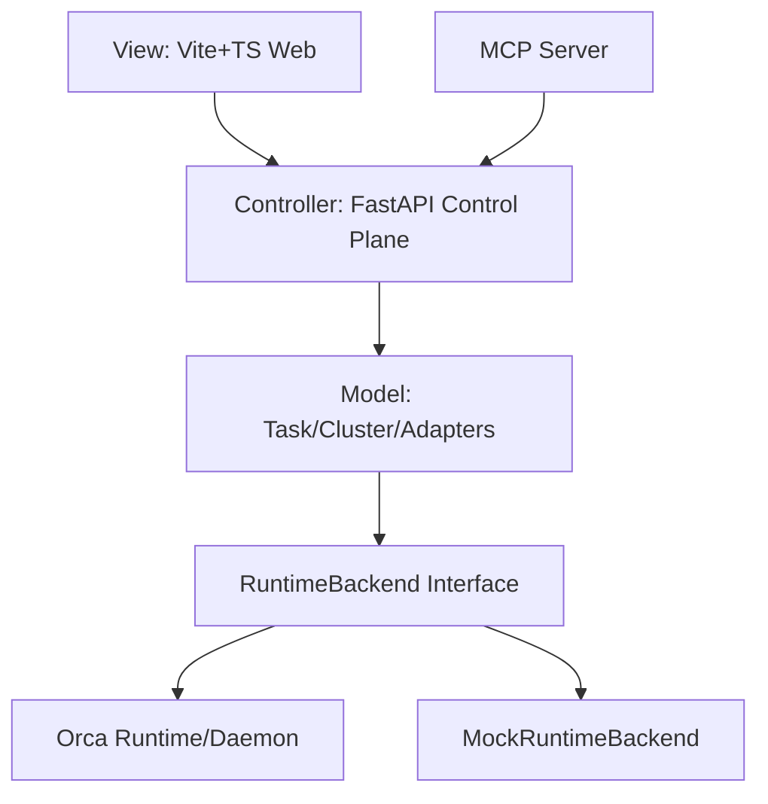

# 规划文档（plan.md）

> 路径约定：`ref/plan.md`  
> 基于：`ref/requirement.md`、`doc/spec/ds.md`  
> 更新日期：2026-10-10

## 1. 方案概述

采用 **旁路 MVC 扩展**：新建 `src/orca_mvc/`（备选 `extensions/mvc/`），通过适配层调用 Orca `SystemRuntime` / daemon REST；Phase1 允许 **MockRuntimeBackend**，以便在未完整安装驱动栈时跑通控制面。SiLA2/ROS2/MCP/Web 均挂在控制面，不侵入 `reservation_manager`。

## 2. 阶段划分

### Phase 0 — 文档与契约（本交付）

- 调研专报、intent、requirement、plan、urs、ds、progress、索引。  
- **出口**：设计可指导编码；验收清单明确。  

### Phase 1 — MVC 扩展最小闭环（优先实现）

| 工作包 | 内容 | 负责人建议 |
|--------|------|------------|
| WP1 模型 | ExperimentTask、Workcell、Cluster、状态枚举、JSON 拓扑 | Engineer |
| WP2 控制面 API | FastAPI：tasks CRUD/提交、cluster 查询、adapters 状态 | Engineer |
| WP3 RuntimeBackend | Protocol + Mock；可选 DaemonClient | Engineer |
| WP4 适配器 stub | SiLA2/ROS2 mock | Engineer |
| WP5 MCP | tools 包装控制面 | Engineer |
| WP6 前端 | Vite+TS 独立端口，任务列表+cell 状态 | Engineer |
| WP7 测试与 README | pytest + 启动说明 | Engineer |
| WP8 审核 | 对照 URS/DS、安全与解耦审查 | Reviewer |

**Phase1 出口**：验收清单全部勾选。

### Phase 2 — 深化集成

- DaemonClient 对接真实 `orca` daemon；  
- MCP 鉴权与网络暴露方案；  
- SiLA2 真实连接器（选 1 类 Feature）；  
- ROS2 真实节点（Humble/Jazzy 择一）；  
- 前端：事件 SSE、blocker/recovery 面板。  

### Phase 3 — 集群调度策略

- 任务到 workcell 的分配启发式/CP-SAT；  
- 跨 cell 转运与 Orca Translator 拓扑对齐；  
- 指标与仿真回放。  

## 3. 任务拆解（Phase1 明细）

1. 创建包结构与 pyproject 入口（若独立）或命名空间包。  
2. 实现模型与内存仓库（InMemoryTaskStore）。  
3. 实现 Control Plane 路由与 Pydantic schema。  
4. 实现 MockRuntimeBackend（异步 sleep 模拟执行）。  
5. 实现 adapters mock。  
6. 实现 MCP server（可用 `mcp` SDK 或最小 JSON-RPC 演示；需在 README 写明依赖）。  
7. 实现 frontend 最小页。  
8. 示例：`examples/mvc_cluster_two_cells.json`。  
9. pytest：test_tasks_parallel、test_cluster_load、test_adapters、test_mcp_tools。  
10. 更新 `ref/progress.md`。  

## 4. 多智能体协同

| 角色 | 职责 |
|------|------|
| 统筹/架构（本角色） | 需求、设计、验收标准、接口边界 |
| Engineer_Grok | 按 ds/plan 编码、单测、README |
| Reviewer_Grok | 对照 URS 审查解耦/安全/契约；缺陷回写 issues |

协作规则：Engineer 不改上游预约内核；Reviewer 以「可回滚、有测试、契约一致」为门禁。

## 5. 测试方案（Phase1）

- 单元：模型状态迁移、拓扑解析。  
- API：httpx/TestClient 提交双任务。  
- 适配器：mock 调用返回。  
- MCP：直接调 tool 函数或测试客户端。  
- 手工：按 README 启前后端截图/日志。  

## 6. 风险与缓解

| 风险 | 缓解 |
|------|------|
| 上游驱动栈安装重 | MockRuntimeBackend 默认 |
| SSPL/安全 | 文档警示；默认 localhost |
| 范围膨胀 | Phase1 冻结真机与鉴权 |
| 双主状态 | ledger 仍以 Orca 为准；控制面只映射任务状态 |

## 7. 日程建议（弹性）

- D0：文档（完成）  
- D1–D2：WP1–WP3  
- D2–D3：WP4–WP6  
- D3：WP7–WP8  
